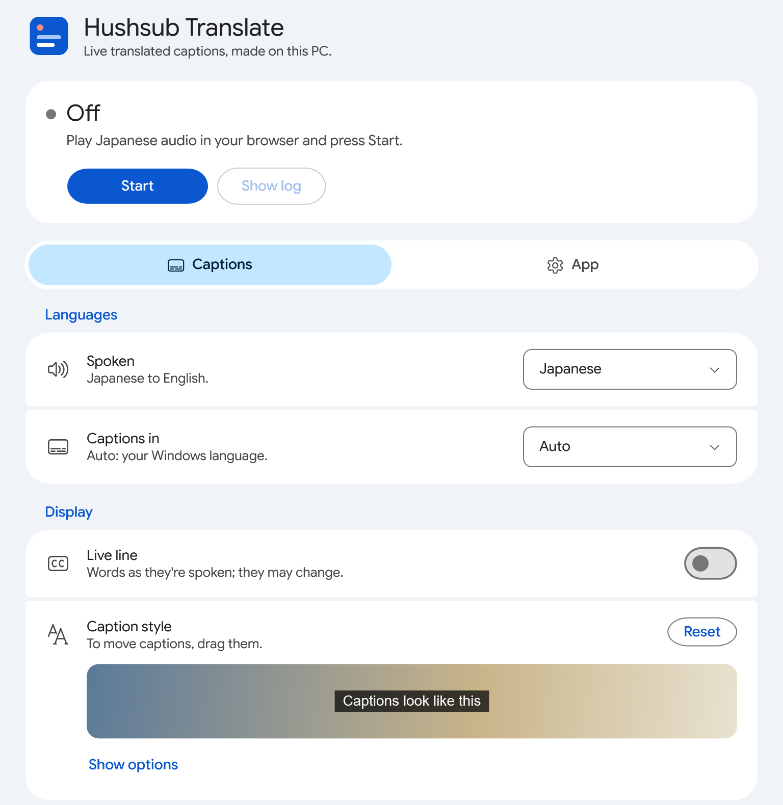

<h1 align="center">Hushsub Translate</h1>

<b>Private subtitles and translation for anything your PC plays.</b> 
Streams, videos, meetings, games and VRChat. Free, offline, no account, no subscription.

Hushsub Translate listens to a browser or app, writes what is said, translates it, and shows it over the screen like
YouTube's CC, live, in sixteen languages. It all runs on your own PC: no audio or text ever leaves it.

  <picture>
    <source media="(prefers-color-scheme: dark)" srcset="docs/app-dark.png">
    
  </picture>

| | Hushsub Translate | Most live translation apps |
|---|---|---|
| Your audio | Stays on your PC | Sent to their servers |
| Price | Free, no limits | Subscription, or a few free minutes |
| Account | None | Sign-up |
| Without internet | Works | Stops |
| Where | Any app or browser: videos, streams, games, VRChat | Often only meetings, or one browser |

## Install

You need Windows 10 or 11 and about 20 GB of free disk space. An NVIDIA graphics card (GTX 10 series or newer, 4 GB
or more) gives the best captions. Without one, captions run on the processor: slower and rougher. AMD and Intel
graphics, macOS, Linux and phones are planned.

1. Click **Download** above and open the ZIP.
2. Double-click **`Hushsub Translate.bat`** in it. That's all: the app installs itself in
   `%LOCALAPPDATA%\Programs\Hushsub Translate` (no administrator), adds itself to the Start menu, downloads the
   engine and models for your PC, and starts captions. The window shows the progress; a cut download resumes.

If Windows warns about the file, click **Run**, or **More info → Run anyway**. To install somewhere else, right-click
the ZIP, **Extract all**, and open `Hushsub Translate.bat` in the extracted folder.

## Use

1. Play the video, stream or meeting in your browser, or in VRChat, Discord, Zoom, Teams or VLC.
2. Open **Hushsub Translate** and press **Start**. Captions appear over the video.
3. Press **Stop** when you are done. **Start** brings them back at once.

- **Languages:** English, Chinese (simplified or traditional), Spanish, French, Portuguese, Russian, Indonesian,
  German, Japanese, Vietnamese, Turkish, Korean, Italian, Polish and Dutch, translated either way. Japanese → English
  is the best tuned.
- **Listen to:** Auto follows the open browser. Pick an app, **All PC sound** for everything, or **Microphone**.
- **Caption style:** YouTube's options. Drag the captions anywhere, and scroll the mouse wheel over them to read
  lines you missed.
- **Live line:** off by default, so captions never change once they show. Turn it on to see words as they're spoken.
- **Show original:** what was said, small, above the translation (and above each line when you scroll back).
- **VRChat chatbox:** with **Listen to** on VRChat or Microphone, also puts each translated line in your VRChat
  chatbox. Microphone: speak and others read your words in their language.
- **Your words:** names the captions get wrong, one per line as `heard = shown`.

The first start of each mode downloads its models (2–8 GB). After that, captions start in under a minute.

## Modes

**Auto** picks the best mode for your graphics card, and steps down if another app needs the memory.

| Mode | Delay | Graphics memory | Translation | Commercial use |
|---|---|---|---|---|
| Accurate | ~1.5 s | 6.2 GB | MiLMMT-46-4B: polished | Yes |
| **Balanced** | ~0.7 s | 3.6 GB | MiLMMT-46-1B: good. Auto's pick on 8 GB cards | Yes |
| Fast | ~1 s | 3.0 GB | LFM2 for Japanese ↔ English, NLLB for the rest. On 6 GB cards | No |
| Lite | ~0.7 s | 2.3 GB | NLLB-600M: basic. On 4 GB cards | No |
| CPU | ~3 s | none | NLLB-600M, with Whisper small: misses more words | No |

Measured on an RTX 4060 Laptop. NLLB is licensed for non-commercial use only: for work, use Balanced or Accurate.

## Troubleshooting

- **No captions:** make sure the sound plays in what **Listen to** picks, or pick **All PC sound**, then click **Show log**.
- **CPU mode on an NVIDIA card:** other apps hold the graphics memory. Close them, then Stop and Start.
- **A download failed:** press **Start** or **Resume** again; it continues where it stopped. If a DNS filter blocks
  it (Cloudflare WARP for Families, NextDNS, Pi-hole), allow `contabostorage.com` until the install finishes.
- **Still stuck:** About → **Send feedback** opens a problem report with your setup filled in, never your captions.

## Privacy

Audio is processed on your PC and captions are never saved. No account, no telemetry, no open network port. Once
its models are downloaded the app works offline. It connects only to:

| When | Where | What |
|---|---|---|
| Install | `contabostorage.com`, `s3.libs.space`, `github.com` | The engine, from Whispering Tiger's servers. `github.com` only checks whether a DNS filter blocks the download. |
| First start of a mode | The same servers; Fast mode also `huggingface.co` | The speech and translation models, each checked against its SHA-256 hash. |
| Updates | `api.github.com`, `github.com` | New releases, only with **Update automatically** on or after **Check for updates**. |
| VRChat chatbox on | `127.0.0.1:9000`: VRChat on this PC | Each translated line, sent only, nothing listens. VRChat then shows it to the people near you. |

Updates change only the app's scripts, never the engine, models, settings or your words.

## More

[Details](https://github.com/peng-win0/hushsub-translate/blob/main/docs/details.md): graphics cards, every setting,
measurements, using it at work (IT rules, several PCs, update policy, model licenses) and how it works.

## License

MIT, see [`LICENSE`](LICENSE). Built on the [Whispering Tiger](https://github.com/Sharrnah/whispering) engine. The
font [Google Sans Flex](https://github.com/googlefonts/googlesans-flex) is under the SIL Open Font License
([`fonts/OFL.txt`](fonts/OFL.txt)). The models keep their own licenses: [Whisper](https://github.com/openai/whisper),
[MiLMMT-46](https://huggingface.co/xiaomi-research/MiLMMT-46-1B-v1.0),
[NLLB-200](https://huggingface.co/facebook/nllb-200-distilled-600M), [LFM2](https://huggingface.co/LiquidAI/LFM2-350M-ENJP-MT)
and [Silero VAD](https://github.com/snakers4/silero-vad).
