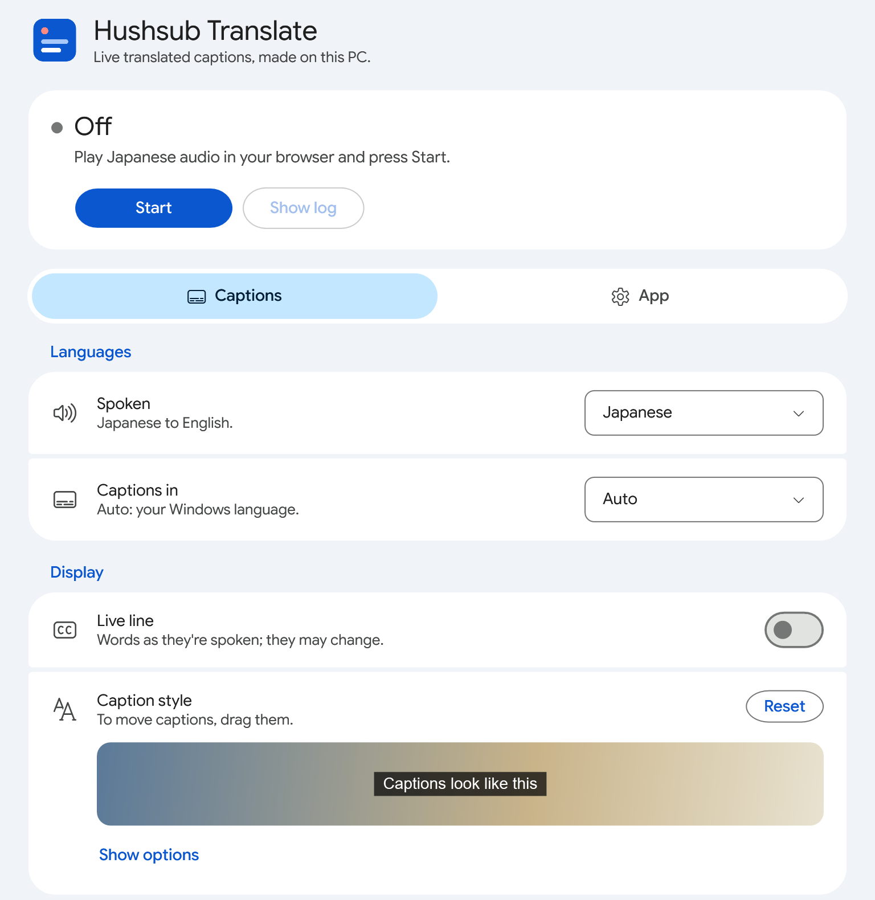

<h1 align="center">Hushsub Translate</h1>

<b>Private live captions and translation for anything your PC plays.</b> 
Streams, videos, meetings, games and VRChat. Free and offline. No account, no subscription.

Hushsub Translate listens to a browser or app, writes down what is said, translates it, and shows it on your screen
like YouTube captions. It works live, in 30 languages. Everything runs on your own PC: no audio or text ever leaves it.

  <picture>
    <source media="(prefers-color-scheme: dark)" srcset="docs/app-dark.png">
    
  </picture>

| | Hushsub Translate | Most live translation apps |
|---|---|---|
| Your audio | Stays on your PC | Sent to their servers |
| Price | Free, no limits | Subscription, or a few free minutes |
| Account | None | Sign-up |
| Without internet | Works | Stops |
| Where | Any app or browser: videos, streams, games, VRChat | Often only meetings, or one browser |

## Install

What you need:

- Windows 10 or 11, and about 20 GB of free disk space.
- For the best captions, an NVIDIA graphics card: GTX 10 series or newer, with 4 GB of memory or more. Without one,
  the app runs on the processor (CPU) instead. That is slower and misses more words.

AMD and Intel graphics, macOS, Linux and phones are planned.

1. Click Download above and open the ZIP.
2. Double-click `Hushsub Translate.bat` inside it.

That's all. The app installs itself in `%LOCALAPPDATA%\Programs\Hushsub Translate` (no administrator rights needed)
and adds itself to the Start menu. Then it downloads the engine (the program that listens and translates) and the
models (the language data it learned from) that suit your PC, and starts captions. The window shows the progress. If
the download is cut off, it picks up where it stopped.

If Windows warns about the file, click Run, or More info and then Run anyway. To install somewhere else, right-click
the ZIP, choose Extract all, and open `Hushsub Translate.bat` in the extracted folder.

## Use

1. Play a video, stream or meeting in your browser, or in VRChat, Discord, Zoom, Teams or VLC.
2. Open Hushsub Translate and press Start. Captions appear over the video.
3. Press Stop when you are done.

If you press Start again within a minute, captions come back at once. After a minute, the app lets the graphics card
rest, so the next Start takes a little longer.

The first time you use each mode, it downloads its models (2 to 8 GB). After that, captions start in under a minute.

The settings:

- **Languages:** English, Chinese (simplified or traditional), Spanish, French, Portuguese, Russian, Indonesian,
  German, Japanese, Vietnamese, Turkish, Korean, Italian, Polish, Dutch, Azerbaijani, Bulgarian, Catalan, Croatian,
  Danish, Finnish, Hebrew, Hungarian, Kazakh, Norwegian, Slovak, Slovenian, Swedish and Tagalog, translated either
  way. Japanese to English works best.
- **Listen to:** Auto follows the open browser. You can also pick one app, All PC sound for everything, or
  Microphone.
- **Caption style:** the same options as YouTube. Drag the captions anywhere. To read lines you missed, scroll the
  mouse wheel over them.
- **Live line:** off by default, so a caption never changes once it shows. Turn it on to see words as they are
  spoken.
- **Show original:** what was said, in small text above the translation (and above each line when you scroll back).
- **VRChat chatbox:** when Listen to is VRChat or Microphone, each translated line also goes to your VRChat chatbox.
  With Microphone, you speak and others read your words in their language.
- **Your words:** names the captions get wrong, one per line, as `heard = shown`.

## Modes

A mode trades speed against quality and graphics memory. Auto picks the best mode for your graphics card, and steps
down if another app needs the memory. Most people can leave it on Auto.

| Mode | Delay | Graphics memory | Translation |
|---|---|---|---|
| Accurate | about 1.5 s | 6.3 GB | Polished (MiLMMT-46-4B) |
| Balanced | about 0.6 s | 3.9 GB | Good (MiLMMT-46-1B). Auto's pick on 8 GB cards. |
| Fast | about 1 s | 3.2 GB | LFM2 for Japanese and English, NLLB for the rest. Auto's pick on 6 GB cards. |
| Lite | about 0.6 s | 2.7 GB | Basic (NLLB-600M). Auto's pick on 4 GB cards. |
| CPU | about 3 s | none | Basic (NLLB-600M). Its speech recognition, Whisper small, misses more words. |

Delay is how long after speech the caption shows, measured on an RTX 4060 Laptop.

For work, use Balanced or Accurate. Fast, Lite and CPU use NLLB, which is licensed for non-commercial use only.

## Troubleshooting

- **No captions:** make sure the sound plays in what Listen to picks, or pick All PC sound. Then click Show log to see
  what the engine says.
- **"Windows blocks the microphone":** open Windows Settings > Privacy & security > Microphone. Turn on Microphone
  access and Let desktop apps access your microphone. Captions then begin.
- **CPU mode on an NVIDIA card:** other apps are using the graphics memory. Close them, then press Stop and Start.
- **A download failed:** press Start or Resume again. It continues where it stopped. If a DNS filter blocks it
  (Cloudflare WARP for Families, NextDNS, Pi-hole), allow `contabostorage.com` until the install finishes.
- **Private Captions 1.4 or older finds no update:** Private Captions is the app's old name, and the page it checks
  is gone. Download the ZIP above and open `Hushsub Translate.bat`. The new version installs next to the old one and
  downloads the engine again. You can then delete the old folder and its shortcuts.
- **Still stuck:** in the app, open About and press Send feedback. It opens a problem report with your setup filled
  in, never your captions.

## Privacy

Audio is processed on your PC, and nothing is uploaded. Captions are never saved. There is no account, no telemetry
(usage tracking) and no open network port. Once its models are downloaded, the app works offline.

The app goes online only for these:

| When | Where | What for |
|---|---|---|
| Install | `contabostorage.com`, `s3.libs.space`, `github.com` | The engine, from Whispering Tiger's servers. `github.com` only checks whether a DNS filter blocks the download. |
| First start of a mode | The same servers. Fast mode also uses `huggingface.co`. | The speech and translation models. Each is checked against its SHA-256 hash, a fingerprint that proves the file is unchanged. |
| Updates | `api.github.com`, `github.com` | New versions, only with Update automatically on, or when you press Check for updates. |
| VRChat chatbox on | `127.0.0.1:9000`, which is VRChat on this PC | Each translated line. The app only sends: nothing listens. VRChat then shows the line to the people near you. |

Updates change only the app's scripts. They never touch the engine, the models, your settings or your words.

## More

[Details](https://github.com/peng-win0/hushsub-translate/blob/main/docs/details.md): which graphics cards work, every
setting, measurements, using it at work (IT rules, several PCs, update policy, model licenses) and how it works.

**Development.** What's in this repository (file by file: [How it works](docs/details.md#how-it-works)):

- `Hushsub Translate.bat` and `CaptionsApp.ps1` open the app and draw its window.
- [`app/`](app) has the scripts that install and run the engine and update the app, each mode's engine settings,
  your words and the font.
- [`Plugins/`](Plugins) has the plugin that translates each line and draws the captions.
- [`bench/`](bench) has the tests and the benchmark kit. `docs/` has the README's pictures, the details page and the
  [runbook](docs/runbook.md). `.github/` has the tests workflow, the issue form and the security policy. These three
  folders aren't in the download.

Installing adds what the repository leaves out: `audioWhisper/` (the Whispering Tiger engine) with a few files of its
own next to it (`markers/`, `websocket_clients/`, `help.bat`, ...), and `toolchain/` (its ffmpeg). Each mode's first
start adds its models to `.cache/`. Git ignores all of them.

To try the code here, clone the repository and open `Hushsub Translate.bat` in the clone. It runs there, not in
`%LOCALAPPDATA%`, and leaves updates to `git pull`. Before a change, run the tests in the runbook's
[Before any change](docs/runbook.md#before-any-change).

## License

MIT, see [`LICENSE`](LICENSE). Built on the [Whispering Tiger](https://github.com/Sharrnah/whispering) engine. The
font [Google Sans Flex](https://github.com/googlefonts/googlesans-flex) is under the SIL Open Font License
([`app/fonts/OFL.txt`](app/fonts/OFL.txt)). The models keep their own licenses: [Whisper](https://github.com/openai/whisper),
[MiLMMT-46](https://huggingface.co/xiaomi-research/MiLMMT-46-1B-v1.0),
[NLLB-200](https://huggingface.co/facebook/nllb-200-distilled-600M), [LFM2](https://huggingface.co/LiquidAI/LFM2-350M-ENJP-MT)
and [Silero VAD](https://github.com/snakers4/silero-vad).
